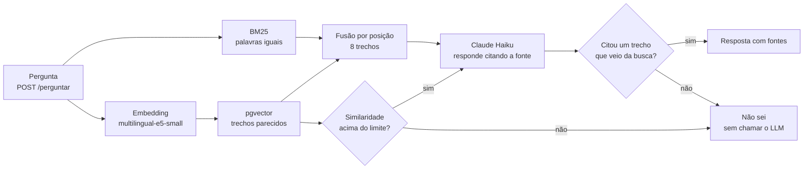

# Assistente de cardápio e FAQ de restaurante (RAG)

API que responde dúvidas de clientes usando só os documentos do restaurante: cardápio, horários, taxas, área de entrega, pagamento e trocas. Toda resposta cita a fonte. Quando os documentos não trazem a resposta, ela diz que não sabe.

O restaurante, o Espetinho da Esquina, é fictício e foi criado para este projeto.

> **Sobre o uso de IA:** este projeto foi desenvolvido com apoio de um assistente de IA (Claude Code), que escreveu o código, os documentos e o gabarito e rodou as avaliações, a partir do plano que defini.

```bash
curl -X POST http://127.0.0.1:8000/perguntar -H "Content-Type: application/json" \
  -d '{"pergunta": "Quanto custa a entrega no Jardim das Flores?"}'
```

```json
{
  "resposta": "A taxa de entrega no Jardim das Flores é de R$ 7,00 [entrega#taxas-de-entrega-por-bairro]. ...",
  "fontes": [{"id": "entrega#taxas-de-entrega-por-bairro", "titulo": "Taxas de entrega por bairro", "trecho": "..."}],
  "sabe": true,
  "motivo": "respondeu"
}
```

## Como funciona



**Três barreiras contra respostas inventadas:** o limite de similaridade, a instrução para o LLM responder `NAO_SEI` e a conferência das citações. Uma resposta sem citação, ou citando um trecho que a busca não trouxe, nunca chega ao cliente.

## Resultados

São 50 perguntas com gabarito, commitadas antes da primeira execução: 20 de desenvolvimento, usadas para os ajustes, e 30 de teste, das quais 6 não têm resposta nos documentos. Uma resposta só conta como correta se trouxer os fatos esperados; uma pergunta sem resposta só conta se houver recusa.

**Busca: antes e depois da melhoria (teste, com 8 trechos)**

| Busca | Fonte certa entre os 8 trechos | MRR |
|---|---|---|
| Só vetor | 95,8% | 0,801 |
| Híbrida (BM25 + vetor) | 95,8% | 0,807 |

**Respostas completas (5 execuções do teste, porque o LLM varia)**

| Busca | Corretas de 30 (média) | Por execução | Recusas corretas de 6 |
|---|---|---|---|
| Só vetor | 28,4 | 29, 28, 28, 28, 29 | 6 em todas |
| **Híbrida** | **29,0** | 29, 29, 29, 29, 29 | 6 em todas |

**RAGAS (uma execução, só nas perguntas respondidas)**

| Busca | Respondidas | Faithfulness | Answer relevancy | Context precision |
|---|---|---|---|---|
| Só vetor | 23 de 30 | 0,883 | 0,928 | 0,841 |
| Híbrida | 24 de 30 | 0,944 | 0,928 | 0,803 |

### Como ler esses números

- **A melhoria é pequena.** A busca híbrida responde cerca de 0,6 pergunta a mais em 30. A busca em si empatou. No RAGAS, a fidelidade sobe e a precisão de contexto cai, mas é uma execução só, e as duas buscas responderam a conjuntos diferentes de perguntas.
- **O maior ganho veio de corrigir um bug.** Com `max_tokens=400`, o raciocínio do modelo consumia o limite e parte das respostas saía cortada. Ao testar um pedido de carne e frango na tela, a resposta falou só da carne: a citação do começo era válida, então a conferência deixava passar. Com o limite maior, o teste foi de 26,8 para 28,4 só com vetor e de 28,2 para 29,0 com a híbrida. Agora, uma resposta cortada vira "não sei".
- **Esses números não são de um teste às cegas.** O conjunto de teste já tinha sido usado antes. O bug apareceu fora dele, as perguntas e o gabarito não mudaram, e não ajustei nada olhando para o teste depois disso.
- **O erro que sobra é da busca híbrida com o pedido atrasado.** A pergunta sobre um pedido com mais de uma hora e meia de atraso erra nas 5 execuções: a resposta fica no tempo médio de entrega e não usa a regra de atraso de 90 minutos. Só com vetor, os erros são essa mesma pergunta, em 3 das 5 execuções, e recusar a pergunta sobre talheres, nas 5.
- **Os ajustes de desenvolvimento foram medidos com o bug.** Passar de 5 para 8 trechos e permitir deduções diretas levou a híbrida de 16 para 19 acertos em 20, mas parte desse efeito pode ter sido o corte. Com a correção, são 20 de 20 com a híbrida e 19 de 20 só com vetor.
- **O limite de similaridade ajuda pouco.** Em 0,80, passam todas as perguntas com resposta, mas só 1 das 5 sem resposta é barrada no desenvolvimento, e nenhuma das 6 no teste. Quem recusa de fato é o LLM. Subir o limite cortaria perguntas boas.
- **A nota é otimista.** Os documentos, as perguntas e o gabarito têm o mesmo autor, e são só 49 trechos. O sistema nunca viu um cliente real.

## O que tem aqui

| Pasta/arquivo | Para quê |
|---|---|
| `documentos/` | Cardápio e regras do restaurante |
| `rag/` | Trechos, embeddings, banco, busca, resposta, API e tela de perguntas |
| `supabase/migrations/` | Tabela, RLS e função de busca, que valem para Supabase e Docker |
| `avaliacao/` | Perguntas, gabarito e medidas |
| `outputs/resultados/` | Respostas e números de cada execução |
| `tests/` | 28 testes, sem depender de banco, modelo ou API paga |
| `.github/workflows/ci.yml` | Lint e testes a cada envio |

## Como rodar

Com Docker:

```bash
cp .env.example .env   # preencha a ANTHROPIC_API_KEY
docker compose up -d --build
docker compose exec api python -m rag.indexar
```

A tela de perguntas fica em `http://127.0.0.1:8000`, e a documentação da API, em `/docs`.

Testes e lint, sem banco, modelo nem chave:

```bash
pip install -r requirements-ci.txt
ruff check .
pytest -q
```

Avaliação, que gasta alguns centavos de API:

```bash
pip install -r requirements-avaliacao.txt
python -m avaliacao.avaliar busca --conjunto teste
python -m avaliacao.avaliar respostas --conjunto teste --modo hibrida --limite 0.80
python -m avaliacao.ragas_avaliar --conjunto teste --modo hibrida
```

## Limitações

- **Ainda não há demo online nem instância no Supabase.** O banco testado é Postgres com pgvector no Docker. A migração foi escrita para valer também no Supabase, mas não foi executada lá.
- **A imagem é grande** (3,6 GB), por causa do PyTorch e do modelo de embeddings dentro dela.
- **Não registra pedidos.** O assistente tira dúvidas e pode somar preços, mas nada do que o cliente pede fica anotado.
- **Respostas não são determinísticas:** o modelo usado não aceita o parâmetro `temperature`.
- **O BM25 fica em memória** e é montado quando a API sobe. Isso serve para 49 trechos, não para uma base grande.
